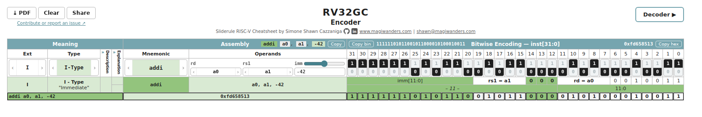
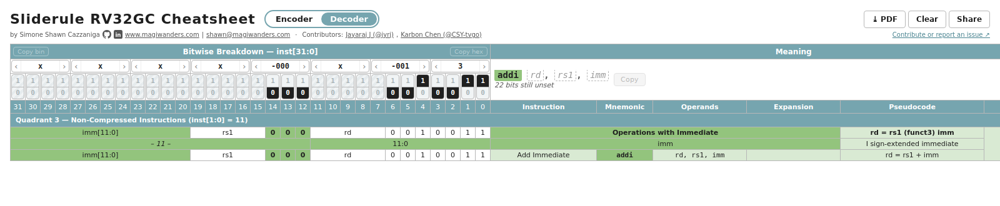

# RISC-V Sliderules

An instruction **encoder** and **decoder** in the browser, laid out like the paper "sliderule" cheatsheets, for
RISC-V RV32GC, the Zilog Z80, the MOS 6502 and the Hack computer of nand2tetris (choose one in the title):
pick an instruction and read its bits, or set bits and read the instruction.

**→ [sliderules.magiwanders.com](https://sliderules.magiwanders.com)**



## Using it

Choose the instruction set in the title: one list, divided by family (RISC-V, MIPS, Intel, Arm, Zilog, MOS Technology,
nand2tetris). RISC-V has a line of extension toggles under the title: **G** frames I, M, A, F, D and toggles them all
(with Zicsr and Zifencei), each letter also toggles on its own, then Q, C, B, Zk, V, H. The ratified Z extensions are
folded under the letter closest to them (Zicsr and Zihintpause under I, Zfh under F, Zcb under C, ...): the small arrow
next to a letter opens them, and the letter counts those turned on. Extensions the sheets have no instructions for yet
are dashed. The sheets show the instructions of the extensions turned on, and the title names the result as the
specification does (RV32GC, RV32IMC, RV32GC_Zihintpause); an extension that needs another (D needs F) brings it along.

Switch between the two sheets with the **Encoder | Decoder** pill next to the title.

**Encoder** (the default). Above each column title sits its selector: scroll over it (or use the arrow keys) to cycle
through its options, or click it for a list (the mnemonic list has a search box).

- **Ext** and **Type** narrow the table down; picking a **Mnemonic** (or clicking one in the table) moves them to
  that instruction.
- **Operands**: one selector per operand. Immediates have a slider and a field that takes decimal, `0x…` or `0b…` and
  only accepts valid values.
- The bits, with their hex digits above, show the encoding. Copy the assembly next to *Assembly*, the binary
  and hex with the buttons either side of *Bitwise Encoding*.
- *Description* and *Explanation* are folded into the narrow **Descr. ›** column: click it to unfold both.



**Decoder**. Set the bits and the instruction builds up next to them, operand by operand. Hover an operand to see
its bits.

- Click the 1 or 0 half of a bit (click again for x, "don't care"), or focus a bit and type: each `0` / `1` sets it
  and moves to the next one, so you can type a whole pattern. `x`, Delete and Backspace clear bits.
- Or set four bits at once with the hex digit above them (scroll it, or click it for a list).
- Paste into a focused bit: a hex word (`0x00a50513`) or a bit pattern (`0101…`, `x` for don't care) fills the row.
- Copy bin / Copy hex (by *Bitwise Breakdown*) and Copy (by the instruction) work once the instruction is complete.
- Click a mnemonic in the table to load its encoding.

**Register buttons**, next to the pill: one per group of the instruction set's registers (*CPU Registers*, *Stack*,
*Float Registers*, *CSRs*, *Flags*, ...). Hover one to see its table (names, encodings, meaning), click it to keep the
table open until you click elsewhere.

**Both views**, top right: **Clear** goes back to the whole sheet, **⤓ PDF** downloads the sheet as you see it (A3;
Clear first for the whole sheet), the arrow on its right offers **⤓ Sail** and **⤓ TableGen**, the
instruction set's Sail and TableGen descriptions (see below; hover them to read whether they are official), **Share** copies a link that reopens exactly
this session: the sheet, selectors, operands, bits, extensions and a register table kept open are all in the link.

## Embedding

One line in any page:

```html
<script type="module" src="https://sliderules.magiwanders.com/embed.js"></script>
```

The sheets appear where an element with `id="sliderules"` is, or at the end of the page if there is none.

## Self-hosting

```sh
git clone https://github.com/magiwanders/riscv_sliderules_cheatsheets.git
cd riscv_sliderules_cheatsheets
npm install
npm run build      # static site in dist/: serve it with any web server
```

For embedding from other sites, the server must send `Access-Control-Allow-Origin` for the `.js` files.
Development: `npm run dev`. Tests: `npm test`.

## Where the instructions come from

Every sheet is generated from a Sail and a TableGen description of its instruction set, checked against each other bit
by bit, plus an overlay (`src/isa/overlay/*.json`) for what such descriptions do not carry: sections, groups, titles,
descriptions, pseudocode, flags, HINT and reserved rows, register meanings.

| Instruction set | Sail | TableGen |
| --- | --- | --- |
| RV32GC | The official [RISC-V Sail model](https://github.com/riscv/sail-riscv) | [LLVM](https://github.com/llvm/llvm-project)'s RISC-V target |
| 6502 | **Unofficial**, written for these sheets: no Sail model of the 6502 exists | [llvm-mos](https://github.com/llvm-mos/llvm-mos) (LLVM for the 6502, not upstream LLVM) |
| Z80 | **Unofficial**, written for these sheets from Zilog's manual | **Unofficial**, likewise |
| Hack | **Unofficial**, written for these sheets from the nand2tetris book | **Unofficial**, likewise |

The unofficial descriptions (`spec/unofficial/`) are only the encoding side of a model (no execute clauses); `llvm-tblgen`
reads the TableGen ones, the Sail compiler has not checked the Sail ones. What makes the sheets trustworthy is the
testing below: two independent assemblers per instruction set. `npm run isa` generates `src/isa/generated/` from all of
them (`tools/isa/`); [spec/README.md](spec/README.md) lists the exact versions and how to update them.

## How the sheets are drawn

The same rules for every instruction set, so a sheet can be read without its legend.

**Cells.** One cell per run of bits of one kind: a literal, one register, one immediate, another field (`aq`, `rl`, `rm`,
`pred`, `succ`, `csr`) or don't care (`–`). Runs are cut where the format's fields are cut (R: funct7 | rs2 | rs1 |
funct3 | rd | opcode), so a funct3 the Sail model writes in two pieces is still one cell. A bit that only one variant
fixes (`shamt[5]` = 0 of the RV32 compressed shifts) has its own cell. Operands the hardware ignores are don't care. The
two exceptions follow the spec's own tables: the 32 bit shifts draw `shamt[5]` inside funct7, `fence.tso` splits
fm | pred | succ.

**Immediates.** Bits are numbered as the value the instruction uses, as the spec's tables do: branch offsets in bytes
(`imm[12|10:5]`), upper immediates as the 32 bit value (`imm[31:12]`, written `imm >> 12` in assembly). Inside a cell
the pieces follow their order in the instruction, `|` between them, `hi:lo` for runs; little-endian addresses read
`addr[7:0|15:8]` in memory order. The name says what the value can be: `imm` signed, `uimm` unsigned, `nz…` when 0
belongs to another row (a HINT or reserved encoding), `shamt` for shifts and `zimm` for the CSR immediate, as in the spec.

**Registers.** `rd`, `rs1`, `rs2`, `rs3`; `rd/rs1` when one field is read and written; `'` for the 3 bit registers of
compressed instructions (x8–x15); `rd!=0`, `rd!={0,2}` when those values are another row.

**Order.** The decoder sorts like the hardware decodes: sections by the lowest bits (RISC-V quadrants 0, 2, 1, 3; the
6502's `cc`) or by prefix (Z80), then by opcode, funct3, funct7. A group is one header row for instructions sharing a
format and a meaning, and writes out the bits they all share, so their rows only show what differs; a row that fixes a
bit the others leave free comes first, so a HINT or reserved row sits above the instruction it is carved out of. Instructions of a group whose
immediates are laid out the same share one immediate row under the header. Once the bits leave one instruction, its row
replaces the header. The encoder lists mnemonics alphabetically, each real instruction before its pseudo-instruction twin.

**Colours.** Each format is one hue in two shades, from the original spreadsheets' palette: the strong shade for the
header, mnemonic and funct bits, the light one for text. Compressed formats take the hue of the 32 bit format they
mirror (CI like I, CB like B, ...), and the other instruction sets reuse the hues by what a format mirrors: registers
red, immediates green, short addresses yellow, long ones blue, pointers purple or magenta, relative jumps orange, bit
operations tan. Registers and opcode bits are white, so colour marks what an instruction does rather than where its
operands are. The pieces of a split immediate cycle through four shades of the format's colour (the colour, then 45 %
towards white, 70 % towards black with white text, 70 % towards white), the same in the instruction row and in the
immediate row under it. Reserved encodings are red, pseudo-instructions magenta, HINTs, unused opcodes and don't-care
bits grey, the unused upper half of a compressed instruction black.

## Testing

`npm test` runs everything below. The version of each sheet is shown next to the title.

| Instruction set | Version | Tested against | Coverage |
| --- | --- | --- | --- |
| RV32GC | v1.0 | GNU as 2.45, LLVM llvm-mc 23.1.5 | 976 vectors each over 212 of the 226 instructions and pseudo-instructions, plus known encodings and round trips of all of them |
| 6502 | v0.1 | py65 1.2.0, ca65 2.19 | 725 vectors (724 for ca65) over the 151 official opcodes; the opcode table equals py65's across all 256 opcodes |
| Z80 | v0.1 | skoolkit 10.2, sjasmplus 1.24.0 | 617 vectors each over the 166 documented forms; all 1,786 opcodes behind every prefix agree with skoolkit, apart from the undocumented ones left out on purpose and `ED 63` / `ED 6B`, which skoolkit only knows as an option |
| Hack | v0.1 | Known encodings | The assembly of the nand2tetris examples, and round trips of every instruction; every word of `Pong.hack` was once checked to decode and reassemble to itself (not part of `npm test`) |
| RV64GC, 8051, 8086, MIPS32, MIPS64, x86, x86_64, ARM Thumb, ARM32, ARM64 | — | — | Coming soon |

**Every sheet with assemblers is bit-perfect against two of them:** every encodable instruction and pseudo-instruction
is encoded by the sheet with random operands and the edges of its immediate's range, the same lines are assembled by
each assembler, and the bytes must match bit for bit. For RV32GC, GNU as and llvm-mc must also agree with each other.
The 14 RV32GC pseudo-instructions left out (`call`, `tail`, `la`, global loads and stores, ...) depend on the linker; ca65
refuses `JMP ($xxFF)` (the NMOS page bug), so those cases are left out for it. `npm test` also generates the data again
from its sources and fails if the committed files differ, which re-checks Sail against TableGen bit by bit.

The references are stored in `test/vectors/` and regenerated with `npm run vectors` (GNU as), `npm run vectors:llvm`
(llvm-mc), `npm run vectors:retro` (py65, skoolkit) and `npm run vectors:retro-asm` (ca65, sjasmplus). These tests cover
bits, mnemonics and instruction lengths: the flags, pseudocode and descriptions of the v0.1 sheets are not checked
against a reference yet.

## Contributing

Issues and suggestions: [open an issue](https://github.com/magiwanders/riscv_sliderules_cheatsheets/issues).
Pull requests are welcome. [CLAUDE.md](CLAUDE.md) explains how the code is organised and how to add an instruction
set extension or a whole instruction set (written for coding agents, readable by humans).

Started as the Summer 2023 RISC-V / LFX Mentorship "Bringing the Sliderules Cheatsheets to the Web".
Licensed under [CC BY-SA 4.0](LICENSE). Contributors: Simone Shawn Cazzaniga ([magiwanders](https://github.com/magiwanders)),
Jayaraj J ([jyrj](https://github.com/jyrj)), Karbon Chen ([CSY-tvgo](https://github.com/CSY-tvgo)).
