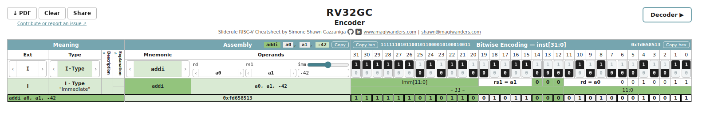
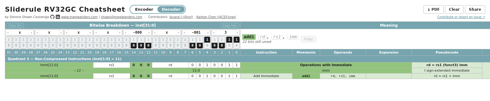

# RISC-V Sliderules

An RV32GC instruction **encoder** and **decoder** in the browser, laid out like the paper "sliderule" cheatsheets:
pick an instruction and read its bits, or set bits and read the instruction.

**→ [sliderules.magiwanders.com](https://sliderules.magiwanders.com)**



## Using it

**Encoder** (the default view). Every column header has its selector: scroll over a selector to cycle through its
options, or click it for a list (the mnemonic list has a search box).

- **Ext** and **Type** narrow the table down; picking a **Mnemonic** moves them to that instruction.
- **Operands**: one selector per operand. Immediates have a slider and a field that takes decimal, `0x…` or `0b…` and
  only accepts valid values.
- The bits, with their hex digits above, show the encoding. Copy the assembly next to *Assembly*, the binary
  and hex with the buttons either side of *Bitwise Encoding*.
- *Description* and *Explanation* are folded into the narrow **Descr. ›** column: click it to unfold both.



**Decoder**. Set the bits and the instruction builds up next to them, operand by operand. Hover an operand to see
its bits.

- Click the 1 or 0 half of a bit (click again for x, "don't care"), or focus a bit and type: each `0` / `1` sets it
  and moves to the next one, so you can type a whole pattern. `x`, Delete and Backspace clear bits.
- Or set four bits at once with the hex digit above them (scroll it, or click it for a list).
- Paste into a focused bit: a hex word (`0x00a50513`) or a bit pattern (`0101…`, `x` for don't care) fills the row.
- Copy bin / Copy hex (by *Bitwise Breakdown*) and Copy (by the instruction) work once the instruction is complete.
- Click a mnemonic in the table to load its encoding.

**Both views**: **⤓ PDF** downloads the sheet as you see it (A3). Press **Clear** first for the whole sheet. **Share**
copies a link that reopens exactly this view: the selectors, operands and bits are all in the link.

## Embedding

One line in any page:

```html
<script type="module" src="https://sliderules.magiwanders.com/embed.js"></script>
```

The sheets appear where an element with `id="sliderules"` is, or at the end of the page if there is none.

## Self-hosting

```sh
git clone https://github.com/magiwanders/riscv_sliderules_cheatsheets.git
cd riscv_sliderules_cheatsheets
npm install
npm run build      # static site in dist/: serve it with any web server
```

For embedding from other sites, the server must send `Access-Control-Allow-Origin` for the `.js` files.
Development: `npm run dev`. Tests: `npm test`.

## Contributing

Issues and suggestions: [open an issue](https://github.com/magiwanders/riscv_sliderules_cheatsheets/issues).
Pull requests are welcome. [CLAUDE.md](CLAUDE.md) explains how the code is organised and how to add an instruction
set extension (written for coding agents, readable by humans).

Started as the Summer 2023 RISC-V / LFX Mentorship "Bringing the Sliderules Cheatsheets to the Web".
Licensed under [CC BY-SA 4.0](LICENSE). Contributors: Simone Shawn Cazzaniga ([magiwanders](https://github.com/magiwanders)),
Jayaraj J ([jyrj](https://github.com/jyrj)), Karbon Chen ([CSY-tvgo](https://github.com/CSY-tvgo)).
