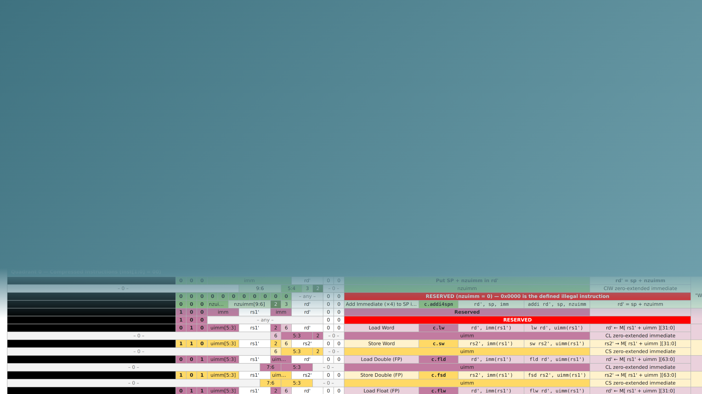
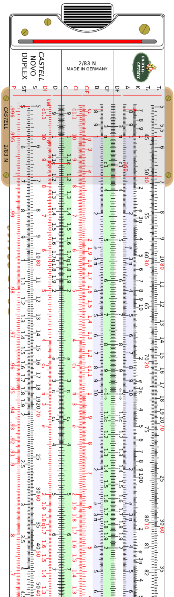
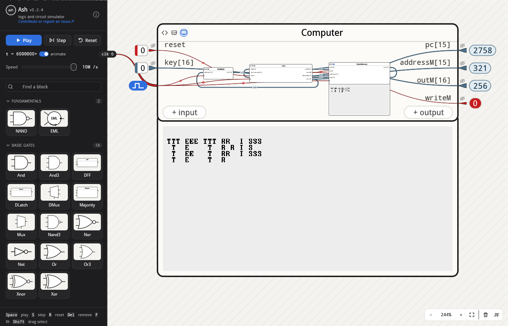
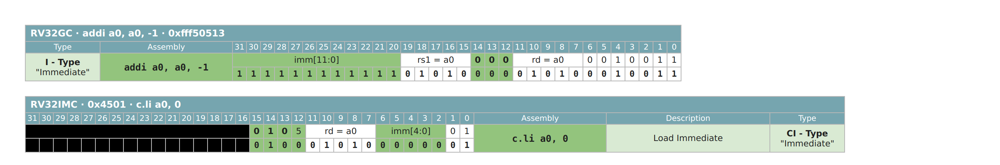

<!-- _class: title -->
<!-- _paginate: false -->

# Instruction Set Sliderules

<p class="sub">An assembly encoder and decoder for the web</p>

<p class="live">Live @ <a href="https://sliderules.magiwanders.com">https://sliderules.magiwanders.com</a></p>

<div class="people">

**Simone Shawn Cazzaniga** ([@magiwanders](https://github.com/magiwanders)) · [shawn@magiwanders.com](mailto:shawn@magiwanders.com)

Contributors: **Jayaraj J** ([@jyrj](https://github.com/jyrj)) · **Siyu Chen** ([@CSY-tvgo](https://github.com/CSY-tvgo))

</div>



---

<!-- _class: dense tl -->

## Timeline

<div class="timeline">
  <div class="ev"><span class="when">2021</span>Involvment with RISC-V Foundation and Academia SIG</div>
  <div class="ev"><span class="when">2022</span>Music &amp; Acoustics MEng, thesis in low level audio hardware</div>
  <div class="ev"><span class="when">2023</span>Excel version of the sliderules</div>
  <div class="ev"><span class="when">2023</span>Hosted the mentorship <em>"Bringing the 'Sliderule' Cheat Sheets to the Web"</em> (Linux Foundation, RISC-V Foundation): mentees <strong>Jayaraj J</strong> and <strong>Siyu Chen</strong> built the first interactive version of sliderules</div>
  <div class="ev"><span class="when"></span>Electroacoustics Design Engineer (R&amp;D) at <strong>BdSound SRL</strong>, Milan, Italy</div>
  <div class="ev"><span class="when">2026</span>UX/UI redesign, new features, ISAs beyond RISC-V</div>
</div>

<div class="vstrip">
  
  <a href="https://sliderulemuseum.com/VirtualSR2/react/faber_castell_2_83n.shtml">https://sliderulemuseum.com/VirtualSR2/react/faber_castell_2_83n.shtml</a>
</div>

---

<!-- _class: ui -->

## Encoder: assembly → bits

<svg class="ui" viewBox="-10 -125 1610 455" xmlns="http://www.w3.org/2000/svg" font-family="DejaVu Sans, sans-serif">
<defs><marker id="ua" viewBox="0 0 10 10" refX="8" refY="5" markerWidth="6" markerHeight="6" orient="auto-start-reverse"><path d="M0,0 L10,5 L0,10 z" fill="#e8590c"/></marker></defs>
<image href="img/ui-encoder.png" x="0" y="0" width="1562" height="170"/>
<rect x="4" y="35" width="218" height="72" rx="6" fill="#e8590c" fill-opacity="0.06" stroke="#e8590c" stroke-width="3"/>
<rect x="274" y="35" width="156" height="72" rx="6" fill="#e8590c" fill-opacity="0.06" stroke="#e8590c" stroke-width="3"/>
<rect x="278" y="7" width="164" height="29" rx="6" fill="#e8590c" fill-opacity="0.06" stroke="#e8590c" stroke-width="3"/>
<rect x="424" y="35" width="366" height="72" rx="6" fill="#e8590c" fill-opacity="0.06" stroke="#e8590c" stroke-width="3"/>
<ellipse cx="737.0" cy="21.5" rx="54.0" ry="12.5" fill="none" stroke="#e8590c" stroke-width="3"/><ellipse cx="819.5" cy="21.5" rx="37.5" ry="12.5" fill="none" stroke="#e8590c" stroke-width="3"/><ellipse cx="1520.0" cy="21.5" rx="39.0" ry="12.5" fill="none" stroke="#e8590c" stroke-width="3"/>
<rect x="216" y="101" width="64" height="27" rx="6" fill="#e8590c" fill-opacity="0.06" stroke="#e8590c" stroke-width="3"/>
<rect x="4" y="122" width="786" height="42" rx="6" fill="#e8590c" fill-opacity="0.06" stroke="#e8590c" stroke-width="3"/>
<rect x="784" y="122" width="774" height="24" rx="6" fill="#e8590c" fill-opacity="0.06" stroke="#e8590c" stroke-width="3"/>
<rect x="784" y="140" width="774" height="24" rx="6" fill="#e8590c" fill-opacity="0.06" stroke="#e8590c" stroke-width="3"/>
<rect x="784" y="35" width="774" height="72" rx="6" fill="#e8590c" fill-opacity="0.06" stroke="#e8590c" stroke-width="3"/>
<polyline points="110,-70 113.0,32" fill="none" stroke="#fff" stroke-width="7" stroke-linecap="round" stroke-linejoin="round"/><polyline points="110,-70 113.0,32" fill="none" stroke="#e8590c" stroke-width="2.5" stroke-linejoin="round" marker-end="url(#ua)"/><text x="110" y="-100" text-anchor="middle" font-size="20" font-weight="bold" fill="#c2410c">Ext · Type</text>
<text x="110" y="-78" text-anchor="middle" font-size="17" fill="#1f2a30">narrow the table</text>
<polyline points="265,-70 262,20 272,62" fill="none" stroke="#fff" stroke-width="7" stroke-linecap="round" stroke-linejoin="round"/><polyline points="265,-70 262,20 272,62" fill="none" stroke="#e8590c" stroke-width="2.5" stroke-linejoin="round" marker-end="url(#ua)"/><text x="265" y="-100" text-anchor="middle" font-size="20" font-weight="bold" fill="#c2410c">Mnemonic</text>
<text x="265" y="-78" text-anchor="middle" font-size="17" fill="#1f2a30">searchable list</text>
<polyline points="520,-70 410,4" fill="none" stroke="#fff" stroke-width="7" stroke-linecap="round" stroke-linejoin="round"/><polyline points="520,-70 410,4" fill="none" stroke="#e8590c" stroke-width="2.5" stroke-linejoin="round" marker-end="url(#ua)"/><text x="520" y="-100" text-anchor="middle" font-size="20" font-weight="bold" fill="#c2410c">Assembly</text>
<text x="520" y="-78" text-anchor="middle" font-size="17" fill="#1f2a30">hover an operand: its bits light up</text>
<polyline points="860,-70 530,32" fill="none" stroke="#fff" stroke-width="7" stroke-linecap="round" stroke-linejoin="round"/><polyline points="860,-70 530,32" fill="none" stroke="#e8590c" stroke-width="2.5" stroke-linejoin="round" marker-end="url(#ua)"/><text x="860" y="-100" text-anchor="middle" font-size="20" font-weight="bold" fill="#c2410c">Operands</text>
<text x="860" y="-78" text-anchor="middle" font-size="17" fill="#1f2a30">slider + dec / 0x / 0b field</text>
<polyline points="1210,-70 737.0,8" fill="none" stroke="#fff" stroke-width="7" stroke-linecap="round" stroke-linejoin="round"/><polyline points="1210,-70 737.0,8" fill="none" stroke="#e8590c" stroke-width="2.5" stroke-linejoin="round" marker-end="url(#ua)"/><polyline points="1210,-70 819.5,8" fill="none" stroke="#fff" stroke-width="7" stroke-linecap="round" stroke-linejoin="round"/><polyline points="1210,-70 819.5,8" fill="none" stroke="#e8590c" stroke-width="2.5" stroke-linejoin="round" marker-end="url(#ua)"/><polyline points="1210,-70 1520.0,8" fill="none" stroke="#fff" stroke-width="7" stroke-linecap="round" stroke-linejoin="round"/><polyline points="1210,-70 1520.0,8" fill="none" stroke="#e8590c" stroke-width="2.5" stroke-linejoin="round" marker-end="url(#ua)"/><text x="1210" y="-100" text-anchor="middle" font-size="20" font-weight="bold" fill="#c2410c">Copy</text>
<text x="1210" y="-78" text-anchor="middle" font-size="17" fill="#1f2a30">assembly · bin · hex</text>
<polyline points="175,208 248.0,131" fill="none" stroke="#fff" stroke-width="7" stroke-linecap="round" stroke-linejoin="round"/><polyline points="175,208 248.0,131" fill="none" stroke="#e8590c" stroke-width="2.5" stroke-linejoin="round" marker-end="url(#ua)"/><text x="175" y="230" text-anchor="middle" font-size="20" font-weight="bold" fill="#c2410c">Descr. ›</text>
<text x="175" y="252" text-anchor="middle" font-size="17" fill="#1f2a30">unfolds description + explanation</text>
<polyline points="490,208 540,167" fill="none" stroke="#fff" stroke-width="7" stroke-linecap="round" stroke-linejoin="round"/><polyline points="490,208 540,167" fill="none" stroke="#e8590c" stroke-width="2.5" stroke-linejoin="round" marker-end="url(#ua)"/><text x="490" y="230" text-anchor="middle" font-size="20" font-weight="bold" fill="#c2410c">The chosen instruction</text>
<text x="490" y="252" text-anchor="middle" font-size="17" fill="#1f2a30">click any mnemonic to pick it</text>
<polyline points="860,208 880,149" fill="none" stroke="#fff" stroke-width="7" stroke-linecap="round" stroke-linejoin="round"/><polyline points="860,208 880,149" fill="none" stroke="#e8590c" stroke-width="2.5" stroke-linejoin="round" marker-end="url(#ua)"/><text x="860" y="230" text-anchor="middle" font-size="20" font-weight="bold" fill="#c2410c">Fields</text>
<text x="860" y="252" text-anchor="middle" font-size="17" fill="#1f2a30">registers white, immediates in colour</text>
<polyline points="1215,208 1250,167" fill="none" stroke="#fff" stroke-width="7" stroke-linecap="round" stroke-linejoin="round"/><polyline points="1215,208 1250,167" fill="none" stroke="#e8590c" stroke-width="2.5" stroke-linejoin="round" marker-end="url(#ua)"/><text x="1215" y="230" text-anchor="middle" font-size="20" font-weight="bold" fill="#c2410c">Immediate row</text>
<text x="1215" y="252" text-anchor="middle" font-size="17" fill="#1f2a30">the immediate's encoding, bit by bit</text>
<polyline points="1460,270 1585,266 1585,71.0 1562,71.0" fill="none" stroke="#fff" stroke-width="7" stroke-linecap="round" stroke-linejoin="round"/><polyline points="1460,270 1585,266 1585,71.0 1562,71.0" fill="none" stroke="#e8590c" stroke-width="2.5" stroke-linejoin="round" marker-end="url(#ua)"/><text x="1460" y="292" text-anchor="middle" font-size="20" font-weight="bold" fill="#c2410c">Encoding</text>
<text x="1460" y="314" text-anchor="middle" font-size="17" fill="#1f2a30">hex digits over the bits</text>
</svg>

---

<!-- _class: ui -->

## Decoder: bits → assembly

<svg class="ui" viewBox="-40 -125 1800 775" xmlns="http://www.w3.org/2000/svg" font-family="DejaVu Sans, sans-serif">
<defs><marker id="ua" viewBox="0 0 10 10" refX="8" refY="5" markerWidth="6" markerHeight="6" orient="auto-start-reverse"><path d="M0,0 L10,5 L0,10 z" fill="#e8590c"/></marker></defs>
<svg x="0" y="0" width="1760" height="216" viewBox="0 0 1760 216"><image href="img/ui-decoder.png" x="0" y="0" width="1760" height="260"/></svg><image href="img/ui-decoder2.png" x="0" y="390" width="1760" height="180"/>
<rect x="4" y="27" width="774" height="72" rx="6" fill="#e8590c" fill-opacity="0.06" stroke="#e8590c" stroke-width="3"/>
<ellipse cx="39.5" cy="17.5" rx="37.5" ry="12.5" fill="none" stroke="#e8590c" stroke-width="3"/>
<ellipse cx="740.0" cy="17.5" rx="39.0" ry="12.5" fill="none" stroke="#e8590c" stroke-width="3"/>
<rect x="1562" y="136" width="186" height="78" rx="6" fill="#e8590c" fill-opacity="0.06" stroke="#e8590c" stroke-width="3"/>
<rect x="775" y="427" width="318" height="56" rx="6" fill="#e8590c" fill-opacity="0.06" stroke="#e8590c" stroke-width="3"/>
<rect x="4" y="526" width="1744" height="42" rx="6" fill="#e8590c" fill-opacity="0.06" stroke="#e8590c" stroke-width="3"/>
<rect x="7" y="117" width="1738" height="22" fill="none" stroke="#e8590c" stroke-width="2"/><rect x="7" y="139" width="1738" height="18" fill="none" stroke="#e8590c" stroke-width="2"/><rect x="7" y="157" width="1738" height="18" fill="none" stroke="#e8590c" stroke-width="2"/><line x1="-12" y1="128" x2="5" y2="128" stroke="#e8590c" stroke-width="2.5"/><circle cx="-22" cy="128" r="8.5" fill="#e8590c"/><text x="-22" y="132" text-anchor="middle" font-size="11.5" font-weight="bold" fill="#fff">1</text><line x1="-12" y1="148" x2="5" y2="148" stroke="#e8590c" stroke-width="2.5"/><circle cx="-22" cy="148" r="8.5" fill="#e8590c"/><text x="-22" y="152" text-anchor="middle" font-size="11.5" font-weight="bold" fill="#fff">2</text><line x1="-12" y1="166" x2="5" y2="166" stroke="#e8590c" stroke-width="2.5"/><circle cx="-22" cy="166" r="8.5" fill="#e8590c"/><text x="-22" y="170" text-anchor="middle" font-size="11.5" font-weight="bold" fill="#fff">3</text>
<polyline points="390,-70 390,47" fill="none" stroke="#fff" stroke-width="7" stroke-linecap="round" stroke-linejoin="round"/><polyline points="390,-70 390,47" fill="none" stroke="#e8590c" stroke-width="2.5" stroke-linejoin="round" marker-end="url(#ua)"/><text x="390" y="-100" text-anchor="middle" font-size="20" font-weight="bold" fill="#c2410c">Bits · hex digits</text>
<text x="390" y="-78" text-anchor="middle" font-size="17" fill="#1f2a30">click 1 / 0 (again: x), type, paste, or set a digit</text>
<polyline points="40,-27 39.5,4" fill="none" stroke="#fff" stroke-width="7" stroke-linecap="round" stroke-linejoin="round"/><polyline points="40,-27 39.5,4" fill="none" stroke="#e8590c" stroke-width="2.5" stroke-linejoin="round" marker-end="url(#ua)"/><text x="40" y="-35" text-anchor="middle" font-size="20" font-weight="bold" fill="#c2410c">Copy bin</text>
<polyline points="830,-27 740.0,4" fill="none" stroke="#fff" stroke-width="7" stroke-linecap="round" stroke-linejoin="round"/><polyline points="830,-27 740.0,4" fill="none" stroke="#e8590c" stroke-width="2.5" stroke-linejoin="round" marker-end="url(#ua)"/><text x="830" y="-35" text-anchor="middle" font-size="20" font-weight="bold" fill="#c2410c">Copy hex</text>
<text x="330" y="265" text-anchor="middle" font-size="20" font-weight="bold" fill="#c2410c">① Section</text>
<text x="330" y="287" text-anchor="middle" font-size="17" fill="#1f2a30">by the lowest bits</text>
<text x="760" y="265" text-anchor="middle" font-size="20" font-weight="bold" fill="#c2410c">② Group header</text>
<text x="760" y="287" text-anchor="middle" font-size="17" fill="#1f2a30">the bits all members share</text>
<text x="1190" y="265" text-anchor="middle" font-size="20" font-weight="bold" fill="#c2410c">③ Shared immediate row</text>
<text x="1190" y="287" text-anchor="middle" font-size="17" fill="#1f2a30">one for the whole group</text>
<polyline points="1600,243 1655.0,217" fill="none" stroke="#fff" stroke-width="7" stroke-linecap="round" stroke-linejoin="round"/><polyline points="1600,243 1655.0,217" fill="none" stroke="#e8590c" stroke-width="2.5" stroke-linejoin="round" marker-end="url(#ua)"/><text x="1600" y="265" text-anchor="middle" font-size="20" font-weight="bold" fill="#c2410c">Type · Ext</text>
<text x="1600" y="287" text-anchor="middle" font-size="17" fill="#1f2a30">format and extension</text>
<polyline points="1265,454 1097,455" fill="none" stroke="#fff" stroke-width="7" stroke-linecap="round" stroke-linejoin="round"/><polyline points="1265,454 1097,455" fill="none" stroke="#e8590c" stroke-width="2.5" stroke-linejoin="round" marker-end="url(#ua)"/><text x="1420" y="448" text-anchor="middle" font-size="20" font-weight="bold" fill="#c2410c">Meaning</text>
<text x="1420" y="470" text-anchor="middle" font-size="17" fill="#1f2a30">the instruction, built as bits are set</text>
<polyline points="880,598 880,571" fill="none" stroke="#fff" stroke-width="7" stroke-linecap="round" stroke-linejoin="round"/><polyline points="880,598 880,571" fill="none" stroke="#e8590c" stroke-width="2.5" stroke-linejoin="round" marker-end="url(#ua)"/><text x="880" y="620" text-anchor="middle" font-size="20" font-weight="bold" fill="#c2410c">One instruction left</text>
<text x="880" y="642" text-anchor="middle" font-size="17" fill="#1f2a30">its own row, operands filled in</text>
</svg>

---

<!-- _class: ui -->

## Header: instruction set, encoder/decoder, registers, tools

<svg class="ui" viewBox="-10 -215 1510 470" xmlns="http://www.w3.org/2000/svg" font-family="DejaVu Sans, sans-serif">
<defs><marker id="ua" viewBox="0 0 10 10" refX="8" refY="5" markerWidth="6" markerHeight="6" orient="auto-start-reverse"><path d="M0,0 L10,5 L0,10 z" fill="#e8590c"/></marker></defs>
<svg x="0" y="0" width="1090" height="92" viewBox="0 0 1090 92"><image href="img/ui-header.png" width="1566" height="92"/></svg><svg x="1150" y="0" width="330" height="92" viewBox="1236 0 330 92"><image href="img/ui-header.png" width="1566" height="92"/></svg><path d="M1108,0 l12,15 l-12,15 l12,15 l-12,15 l12,15 l-12,15" fill="none" stroke="#b8c8ce" stroke-width="2"/><path d="M1128,0 l12,15 l-12,15 l12,15 l-12,15 l12,15 l-12,15" fill="none" stroke="#b8c8ce" stroke-width="2"/>
<rect x="133" y="5" width="202" height="36" rx="6" fill="#e8590c" fill-opacity="0.06" stroke="#e8590c" stroke-width="3"/>
<rect x="496" y="13" width="38" height="20" rx="6" fill="#e8590c" fill-opacity="0.06" stroke="#e8590c" stroke-width="3"/>
<rect x="542" y="6" width="190" height="35" rx="6" fill="#e8590c" fill-opacity="0.06" stroke="#e8590c" stroke-width="3"/>
<rect x="736" y="8" width="346" height="31" rx="6" fill="#e8590c" fill-opacity="0.06" stroke="#e8590c" stroke-width="3"/>
<rect x="1310" y="6" width="94" height="34" rx="6" fill="#e8590c" fill-opacity="0.06" stroke="#e8590c" stroke-width="3"/>
<rect x="1402" y="6" width="72" height="34" rx="6" fill="#e8590c" fill-opacity="0.06" stroke="#e8590c" stroke-width="3"/>
<rect x="8" y="44" width="435" height="24" rx="6" fill="#e8590c" fill-opacity="0.06" stroke="#e8590c" stroke-width="3"/>
<rect x="5" y="68" width="761" height="20" rx="6" fill="#e8590c" fill-opacity="0.06" stroke="#e8590c" stroke-width="3"/>
<rect x="1245" y="6" width="67" height="34" rx="6" fill="#e8590c" fill-opacity="0.06" stroke="#e8590c" stroke-width="3"/>
<rect x="1156" y="70" width="318" height="17" rx="6" fill="#e8590c" fill-opacity="0.06" stroke="#e8590c" stroke-width="3"/>
<polyline points="300,-116 234.0,2" fill="none" stroke="#fff" stroke-width="7" stroke-linecap="round" stroke-linejoin="round"/><polyline points="300,-116 234.0,2" fill="none" stroke="#e8590c" stroke-width="2.5" stroke-linejoin="round" marker-end="url(#ua)"/><text x="300" y="-190" text-anchor="middle" font-size="20" font-weight="bold" fill="#c2410c">Instruction set</text>
<text x="300" y="-168" text-anchor="middle" font-size="17" fill="#1f2a30">its name follows the extensions below</text>
<text x="300" y="-146" text-anchor="middle" font-size="17" fill="#1f2a30">now: RV32 · RV64 · Z80 · 6502 · Hack</text>
<text x="300" y="-124" text-anchor="middle" font-size="17" fill="#1f2a30">soon: MIPS32/64 · 8051 · 8086 · x86 · x86-64 · Thumb · A32 · A64</text>
<polyline points="470,-30 515.0,10" fill="none" stroke="#fff" stroke-width="7" stroke-linecap="round" stroke-linejoin="round"/><polyline points="470,-30 515.0,10" fill="none" stroke="#e8590c" stroke-width="2.5" stroke-linejoin="round" marker-end="url(#ua)"/><text x="470" y="-60" text-anchor="middle" font-size="20" font-weight="bold" fill="#c2410c">Version</text>
<text x="470" y="-38" text-anchor="middle" font-size="17" fill="#1f2a30">of this sheet</text>
<polyline points="700,-95 637.0,3" fill="none" stroke="#fff" stroke-width="7" stroke-linecap="round" stroke-linejoin="round"/><polyline points="700,-95 637.0,3" fill="none" stroke="#e8590c" stroke-width="2.5" stroke-linejoin="round" marker-end="url(#ua)"/><text x="700" y="-125" text-anchor="middle" font-size="20" font-weight="bold" fill="#c2410c">Encoder | Decoder</text>
<text x="700" y="-103" text-anchor="middle" font-size="17" fill="#1f2a30">switch the sheet</text>
<polyline points="930,-30 909.0,5" fill="none" stroke="#fff" stroke-width="7" stroke-linecap="round" stroke-linejoin="round"/><polyline points="930,-30 909.0,5" fill="none" stroke="#e8590c" stroke-width="2.5" stroke-linejoin="round" marker-end="url(#ua)"/><text x="930" y="-60" text-anchor="middle" font-size="20" font-weight="bold" fill="#c2410c">Register tables</text>
<text x="930" y="-38" text-anchor="middle" font-size="17" fill="#1f2a30">hover; click to keep open</text>
<polyline points="1150,-95 1357.0,3" fill="none" stroke="#fff" stroke-width="7" stroke-linecap="round" stroke-linejoin="round"/><polyline points="1150,-95 1357.0,3" fill="none" stroke="#e8590c" stroke-width="2.5" stroke-linejoin="round" marker-end="url(#ua)"/><text x="1150" y="-125" text-anchor="middle" font-size="20" font-weight="bold" fill="#c2410c">⤓ PDF  A4 landscape</text>
<text x="1150" y="-103" text-anchor="middle" font-size="17" fill="#1f2a30">▾ A3 portrait · Sail · TableGen</text>
<polyline points="1365,-138 1438.0,3" fill="none" stroke="#fff" stroke-width="7" stroke-linecap="round" stroke-linejoin="round"/><polyline points="1365,-138 1438.0,3" fill="none" stroke="#e8590c" stroke-width="2.5" stroke-linejoin="round" marker-end="url(#ua)"/><text x="1365" y="-190" text-anchor="middle" font-size="20" font-weight="bold" fill="#c2410c">Share</text>
<text x="1365" y="-168" text-anchor="middle" font-size="17" fill="#1f2a30">a link to EXACTLY this view</text>
<text x="1365" y="-146" text-anchor="middle" font-size="17" fill="#1f2a30">sheet · choices · bits · exts</text>
<polyline points="260,148 230,71" fill="none" stroke="#fff" stroke-width="7" stroke-linecap="round" stroke-linejoin="round"/><polyline points="260,148 230,71" fill="none" stroke="#e8590c" stroke-width="2.5" stroke-linejoin="round" marker-end="url(#ua)"/><text x="260" y="170" text-anchor="middle" font-size="20" font-weight="bold" fill="#c2410c">Extensions</text>
<text x="260" y="192" text-anchor="middle" font-size="17" fill="#1f2a30">choose which extensions the sheets show</text>
<polyline points="760,148 640,91" fill="none" stroke="#fff" stroke-width="7" stroke-linecap="round" stroke-linejoin="round"/><polyline points="760,148 640,91" fill="none" stroke="#e8590c" stroke-width="2.5" stroke-linejoin="round" marker-end="url(#ua)"/><text x="760" y="170" text-anchor="middle" font-size="20" font-weight="bold" fill="#c2410c">Credits</text>
<text x="760" y="192" text-anchor="middle" font-size="17" fill="#1f2a30">author and contributors</text>
<polyline points="1120,148 1278.5,43" fill="none" stroke="#fff" stroke-width="7" stroke-linecap="round" stroke-linejoin="round"/><polyline points="1120,148 1278.5,43" fill="none" stroke="#e8590c" stroke-width="2.5" stroke-linejoin="round" marker-end="url(#ua)"/><text x="1120" y="170" text-anchor="middle" font-size="20" font-weight="bold" fill="#c2410c">Clear</text>
<text x="1120" y="192" text-anchor="middle" font-size="17" fill="#1f2a30">back to the whole sheet</text>
<polyline points="1360,203 1400,90" fill="none" stroke="#fff" stroke-width="7" stroke-linecap="round" stroke-linejoin="round"/><polyline points="1360,203 1400,90" fill="none" stroke="#e8590c" stroke-width="2.5" stroke-linejoin="round" marker-end="url(#ua)"/><text x="1360" y="225" text-anchor="middle" font-size="20" font-weight="bold" fill="#c2410c">License · issues</text>
<text x="1360" y="247" text-anchor="middle" font-size="17" fill="#1f2a30">CC BY-SA 4.0, contribute</text>
</svg>

---

## Structure

<svg class="schema" viewBox="0 0 1150 560" xmlns="http://www.w3.org/2000/svg" font-family="DejaVu Sans, sans-serif">
  <defs>
    <marker id="ah" viewBox="0 0 10 10" refX="9" refY="5" markerWidth="7" markerHeight="7" orient="auto-start-reverse"><path d="M0,0 L10,5 L0,10 z" fill="#3f7280"/></marker>
  </defs>
  <g stroke="#3f7280" stroke-width="3" fill="none" marker-end="url(#ah)">
    <line x1="500" y1="198" x2="500" y2="116"/>
    <line x1="868" y1="157" x2="505" y2="157"/>
    <line x1="330" y1="330" x2="330" y2="266"/>
    <line x1="670" y1="330" x2="670" y2="266"/>
  </g>
  <rect x="170" y="2" width="660" height="112" rx="10" fill="#74a4b0" stroke="#3f7280" stroke-width="2"/>
  <text x="500" y="30" text-anchor="middle" font-size="19" font-weight="bold" fill="#fff">Visualization</text>
  <rect x="190" y="44" width="300" height="54" rx="6" fill="#fff" fill-opacity="0.85"/>
  <text x="340" y="72" text-anchor="middle" font-size="22" font-weight="bold" fill="#1f2a30">Encoder</text>
  <text x="340" y="91" text-anchor="middle" font-size="14" fill="#4a5a60">assembly → bits</text>
  <rect x="510" y="44" width="300" height="54" rx="6" fill="#fff" fill-opacity="0.85"/>
  <text x="660" y="72" text-anchor="middle" font-size="22" font-weight="bold" fill="#1f2a30">Decoder</text>
  <text x="660" y="91" text-anchor="middle" font-size="14" fill="#4a5a60">bits → assembly</text>
  <rect x="870" y="30" width="278" height="254" rx="8" fill="#dcecd3" stroke="#93c47d" stroke-width="2"/>
  <text x="1009" y="60" text-anchor="middle" font-size="22" font-weight="bold" fill="#1f2a30">JSON</text>
  <text x="1009" y="84" text-anchor="middle" font-size="13" font-weight="bold" letter-spacing="1.5" fill="#7a8d94">COLUMNS</text>
  <text x="1009" y="108" text-anchor="middle" font-size="16" fill="#1f2a30">Ext · Instruction</text>
  <text x="1009" y="132" text-anchor="middle" font-size="16" fill="#1f2a30">Description · Explanation</text>
  <text x="1009" y="156" text-anchor="middle" font-size="16" fill="#1f2a30">Pseudocode</text>
  <text x="1009" y="180" text-anchor="middle" font-size="16" fill="#1f2a30">section and group rows</text>
  <text x="1009" y="204" text-anchor="middle" font-size="16" fill="#1f2a30">HINT / reserved rows</text>
  <text x="1009" y="228" text-anchor="middle" font-size="13" font-weight="bold" letter-spacing="1.5" fill="#7a8d94">REGISTERS</text>
  <text x="1009" y="252" text-anchor="middle" font-size="16" fill="#1f2a30">Meaning · Saver</text>
  <rect x="170" y="200" width="660" height="64" rx="8" fill="#d5e4e8" stroke="#3f7280" stroke-width="2"/>
  <text x="500" y="240" text-anchor="middle" font-size="22" font-weight="bold" fill="#1f2a30">Functional instruction set model</text>
  <rect x="170" y="332" width="320" height="224" rx="8" fill="#eef2f4" stroke="#b8c8ce" stroke-width="2"/>
  <text x="330" y="364" text-anchor="middle" font-size="22" font-weight="bold" fill="#1f2a30">LLVM TableGen</text>
  <text x="330" y="388" text-anchor="middle" font-size="17" fill="#3f7280">behaviour</text>
  <text x="330" y="420" text-anchor="middle" font-size="13" font-weight="bold" letter-spacing="1.5" fill="#7a8d94">COLUMNS</text>
  <text x="330" y="441" text-anchor="middle" font-size="16" fill="#1f2a30">Mnemonic · Operands</text>
  <text x="330" y="462" text-anchor="middle" font-size="16" fill="#1f2a30">Type · Expansion</text>
  <text x="330" y="483" text-anchor="middle" font-size="13" font-weight="bold" letter-spacing="1.5" fill="#7a8d94">REGISTERS</text>
  <text x="330" y="504" text-anchor="middle" font-size="16" fill="#1f2a30">Register · ABI Name</text>
  <text x="330" y="525" text-anchor="middle" font-size="16" fill="#1f2a30">Encoding · Compressed (')</text>
  <text x="330" y="546" text-anchor="middle" font-size="16" fill="#1f2a30">CSR Address · Access</text>
  <rect x="510" y="332" width="320" height="224" rx="8" fill="#eef2f4" stroke="#b8c8ce" stroke-width="2"/>
  <text x="670" y="364" text-anchor="middle" font-size="22" font-weight="bold" fill="#1f2a30">Sail</text>
  <text x="670" y="388" text-anchor="middle" font-size="17" fill="#3f7280">encoding</text>
  <text x="670" y="420" text-anchor="middle" font-size="13" font-weight="bold" letter-spacing="1.5" fill="#7a8d94">COLUMNS</text>
  <text x="670" y="441" text-anchor="middle" font-size="16" fill="#1f2a30">Bitwise Encoding (encoder)</text>
  <text x="670" y="462" text-anchor="middle" font-size="16" fill="#1f2a30">Bitwise Breakdown (decoder)</text>
  <text x="670" y="483" text-anchor="middle" font-size="16" fill="#1f2a30">opcode · funct bits</text>
  <text x="670" y="504" text-anchor="middle" font-size="16" fill="#1f2a30">operand fields</text>
  <text x="670" y="525" text-anchor="middle" font-size="16" fill="#1f2a30">immediate bit order</text>
</svg>

---

## Ash integration: one line of the sheet, anywhere

<div class="cols">
<div>

```html
<script type="module"
  src="https://sliderules.magiwanders.com/line.js">
</script>
```

```js
const line = window.sliderulesLine;
line.encoderLine({ isa: 'rv32gc',
                   assembly: 'addi a0, a0, -1' });
line.decoderLine({ isa: 'rv32gc', bytes: [0x01, 0x45] });
line.show({ isa, bytes, x, y });   // popup by the pointer
```

</div>
<div>



</div>
</div>

**[Ash](https://ash.magiwanders.com)**, a simulator from NAND gates up to the Hack and RISC-V computers: hover an instruction, its bits or a byte of memory and its sliderules line pops up.


