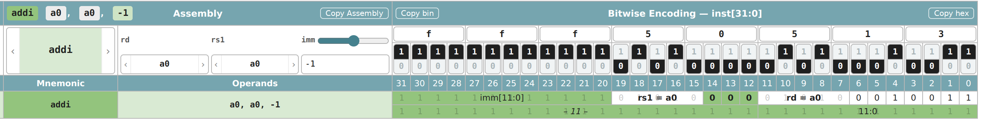
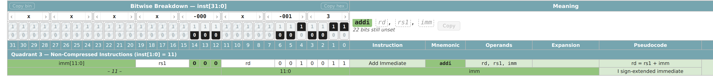
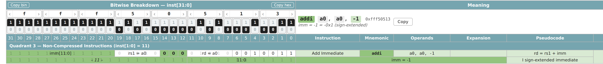

<!-- _class: title -->
<!-- _paginate: false -->

# Instruction Set Sliderules

<p class="sub">An assembly encoder and decoder for the web</p>

<p class="live">Live @ <a href="https://sliderules.magiwanders.com">https://sliderules.magiwanders.com</a></p>

<div class="people">

**Simone Shawn Cazzaniga** ([@magiwanders](https://github.com/magiwanders)) · [shawn@magiwanders.com](mailto:shawn@magiwanders.com)

Contributors: **Jayaraj J** ([@jyrj](https://github.com/jyrj)) · **Siyu Chen** ([@CSY-tvgo](https://github.com/CSY-tvgo))

</div>


---

<!-- _class: dense tl -->

## Timeline

<div class="timeline">
  <div class="ev"><span class="when">2022</span>Music &amp; Acoustics MEng, thesis in low level audio hardware</div>
  <div class="ev"><span class="when">2023</span>Excel version of the sliderules</div>
  <div class="ev"><span class="when">2023</span>Hosted the mentorship <em>"Bringing the 'Sliderule' Cheat Sheets to the Web"</em> (Linux Foundation, RISC-V Foundation): mentees <strong>Jayaraj J</strong> and <strong>Siyu Chen</strong> built the first interactive version of sliderules</div>
  <div class="ev"><span class="when"></span>Electroacoustics Design Engineer (R&amp;D) at <strong>BdSound SRL</strong>, Milan, Italy</div>
  <div class="ev"><span class="when">2026</span>UX/UI redesign, new features, ISAs beyond RISC-V</div>
</div>

<div class="vstrip">
  
  <a href="https://sliderulemuseum.com/VirtualSR2/react/faber_castell_2_83n.shtml">https://sliderulemuseum.com/VirtualSR2/react/faber_castell_2_83n.shtml</a>
</div>

---

## Encoder: pick an instruction, read its bits



- Pick **extension**, **type**, **mnemonic**, then each **operand**: sliders and `0x…` / `0b…` fields that only take valid values
- The bits update live, grouped by field, hex digits on top; copy assembly, binary or hex
- **RV32 / RV64** with every ratified extension (1,142 / 1,245 instructions), **Z80**, **6502**, **Hack**
- Generated from the official **Sail** model, **LLVM TableGen** and the **Unified Database**; **bit-perfect against GNU as and llvm-mc**

---

## Decoder: set bits, read the instruction





- Click or type bits (`0`, `1`, `x` = don't care), or **paste a word** (`0xfff50513`)
- The table **narrows as you go**: 10 bits set and only `addi` is left; 32 and it reads `addi a0, a0, -1`
- Sorted as hardware decodes: quadrant, opcode, funct3, funct7
- **Share** puts the session in a link; **⤓ PDF** prints the sheet as shown

---

## Ash integration: one line of the sheet, anywhere

<div class="cols">
<div>

```html
<script type="module"
  src="https://sliderules.magiwanders.com/line.js">
</script>
```

```js
const line = window.sliderulesLine;
line.encoderLine({ isa: 'rv32gc',
                   assembly: 'addi a0, a0, -1' });
line.decoderLine({ isa: 'rv32gc', bytes: [0x01, 0x45] });
line.show({ isa, bytes, x, y });   // popup by the pointer
```

</div>
<div>


</div>
</div>

**[Ash](https://ash.magiwanders.com)**, a simulator from NAND gates up to the Hack and RISC-V computers: hover an instruction, its bits or a byte of memory and its sliderules line pops up.


